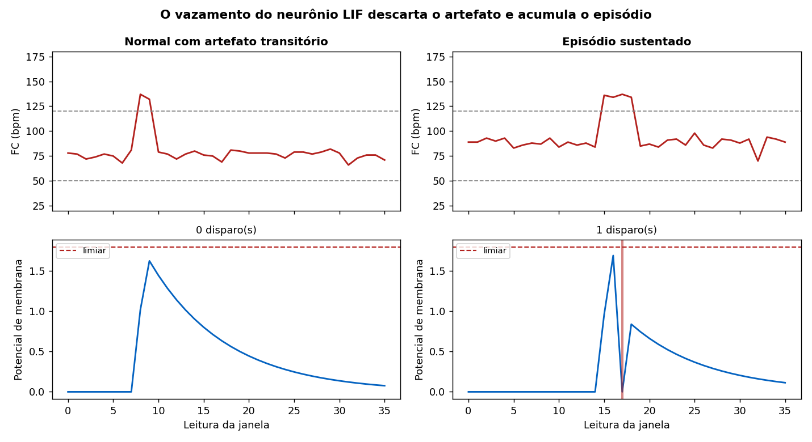

# Ir Além 2 — IA em séries temporais de saúde

**CardioIA — Fase 3 — Grupo Purkinje — FIAP 2TIAOR-2026**

Comparação entre **regressão logística** e um **neurônio integra-e-dispara com vazamento (LIF)** na detecção de episódios arrítmicos em séries de frequência cardíaca geradas pelo wearable da Fase 3.

**🎥 Vídeo (não listado):** <https://youtu.be/psNuK_W5dCM>

## Rodar

```bash
cd ir-alem-2
pip install numpy scikit-learn matplotlib
python src/gerar_series.py      # gera as 1200 janelas
python src/experimento.py       # treina, avalia e salva métricas e figuras
```

Ou abra o notebook, que já vem **com todas as saídas executadas**:

```
notebooks/CardioIA_IrAlem2_SeriesTemporais.ipynb
```

## O que o enunciado pede e onde está

| Entregável | Arquivo |
|---|---|
| Notebook Python comentado | `notebooks/CardioIA_IrAlem2_SeriesTemporais.ipynb` |
| Relatório comparativo (2 páginas) | `docs/RELATORIO_IR_ALEM_2.md` e o PDF em `docs/` |
| Vídeo de até 4 min, não listado | roteiro em `docs/ROTEIRO_VIDEO.md` |
| Repositório público com README | este arquivo |

## A ideia central

O que separa um episódio arrítmico de um artefato de movimento **não é o valor da frequência, é a persistência do desvio**. Um pico isolado de 130 bpm é ruído; 130 bpm por quinze leituras é um evento clínico.

O firmware da Fase 3 resolve isso com um contador de histerese explícito. Um neurônio LIF resolve o mesmo problema **sem contador nenhum**, pela dinâmica da membrana: a corrente carrega o potencial, o vazamento o descarrega. O pico isolado vaza antes do limiar; o desvio sustentado dispara.

**A constante de tempo τ é a histerese**, em tempo contínuo em vez de contagem discreta.



No painel esquerdo o artefato carrega a membrana até 1,65 e vaza sem atingir o limiar de 1,8. No direito, o episódio sustentado cruza e dispara.

## Resultados

| Modelo | Acurácia | Precisão | Revocação | F1 | AUC |
|---|---|---|---|---|---|
| Regressão (série crua) | 0,9694 | 0,9640 | 0,9571 | 0,9606 | 0,9955 |
| **Regressão (com contagem)** | **0,9778** | **0,9783** | **0,9643** | **0,9712** | **0,9986** |
| Neurônio LIF | 0,9556 | 0,9627 | 0,9214 | 0,9416 | 0,9584 |

**Latência de detecção** — LIF: 19,9 leituras em média. Regressão: 36, por construção. **81 segundos de vantagem** na cadência do wearable.

**Memória** — LIF guarda um número (o potencial). A regressão guarda a janela inteira.

## A leitura honesta

A regressão venceu em acurácia, mas treinamos duas variantes de propósito: com a série crua ela faz 96,9 %, e só chega a 97,8 % quando recebe a contagem de leituras fora da faixa. **Boa parte da vantagem é da engenharia de atributos, não do classificador.**

O LIF perdeu em acurácia — 11 episódios perdidos contra 5 — e ganhou em latência, por arquitetura e não por ajuste. Em aplicação clínica, falso negativo custa mais que falso positivo, e esse é o argumento mais forte contra usá-lo sozinho.

**Recomendação híbrida:** LIF na borda, pela latência e pela memória; regressão na névoa, com a janela completa, confirmando. É a mesma divisão que a Fase 3 já faz entre o ESP32 e o Node-RED.

## A descoberta que fecha o projeto

O neurônio, ajustado por busca em grade e **sem saber nada de fisiologia**, convergiu para a mesma estratégia que escrevemos à mão no firmware: exigir persistência antes de acreditar no desvio.

Duas formas muito distintas de pensar o problema chegaram à mesma ideia. Isso sugere que a histerese não foi escolha arbitrária de projeto, e sim a resposta natural para distinguir sinal de artefato em séries fisiológicas.

## Estrutura

```
ir-alem-2/
├── src/
│   ├── gerar_series.py      # 1200 janelas, semente 20260806
│   ├── modelos.py           # atributos da regressão + neurônio LIF
│   └── experimento.py       # treino, avaliação e figuras
├── notebooks/
│   └── CardioIA_IrAlem2_SeriesTemporais.ipynb   (executado)
├── dados/series_card0056.npz
├── resultados/
│   ├── metricas.json
│   ├── fig1_intuicao_lif.png
│   ├── fig2_comparativo.png
│   └── fig3_latencia.png
└── docs/
    ├── RELATORIO_IR_ALEM_2.md
    └── ROTEIRO_VIDEO.md
```

## Reprodutibilidade

Semente `20260806` em toda parte — a mesma desde a Fase 1. Rodar `gerar_series.py` e `experimento.py` em qualquer máquina reproduz exatamente os números desta página.
